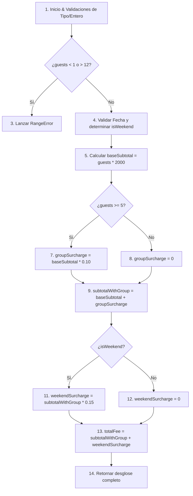

# Etapa 5: Diseño de Casos de Prueba (Caja Negra y Caja Blanca)

**Asignatura:** Verificación y Validación de Software (3° Año TSDS - UPC)  
**Proyecto:** Sistema de Reservas para Resto-Bar  
**Integrantes:** Alex Combina (Desarrollo) y Fabrizio Magnelli (QA y Gestión)  
**Fecha:** 27 de Octubre de 2026  

---

## 1. Técnicas de Diseño de Pruebas Aplicadas

Para garantizar la cobertura integral del sistema, se aplicaron dos perspectivas complementarias:
1. **Técnicas de Caja Negra:**
   - **Partición en Clases de Equivalencia (CE):** Identificación de conjuntos de datos válidos e inválidos.
   - **Análisis de Valores Límite (AVL):** Comprobación en las fronteras de los rangos numéricos y temporales.
2. **Técnicas de Caja Blanca:**
   - Análisis estructural del flujo de control en la función `calculateDepositFee()`.
   - Cobertura de Sentencias (Statement Coverage), Cobertura de Decisiones/Ramas (Branch Coverage) y Cobertura de Caminos Básicos.

---

## 2. Análisis de Clases de Equivalencia y Valores Límite

### A. Variable: Cantidad de Comensales (`guests`) - Rango Válido: [1, 12]
- **Clases Válidas:**
  - $CE_{V1}$: Grupo estándar sin recargo $[1, 4]$.
  - $CE_{V2}$: Grupo numeroso con 10% de recargo $[5, 12]$.
- **Clases Inválidas:**
  - $CE_{I1}$: Comensales $< 1$ (0 o números negativos).
  - $CE_{I2}$: Comensales $> 12$ (13 o superior).
  - $CE_{I3}$: No enteros o tipos no numéricos (`null`, `undefined`, `"cuatro"`, `3.5`).
- **Valores Límite (AVL):**
  - Frontera inferior: $0$ (inválido), $1$ (límite inferior válido), $2$ (nominal).
  - Frontera de recargo: $4$ (límite superior sin recargo), $5$ (límite inferior con recargo 10%).
  - Frontera superior: $11$ (nominal), $12$ (límite superior válido), $13$ (inválido superior).

### B. Variable: Día de la Semana / Fin de Semana
- **Clases Válidas:**
  - $CE_{D1}$: Días de semana sin recargo (Domingo a Jueves).
  - $CE_{D2}$: Fin de semana con 15% de recargo (Viernes o Sábado).

### C. Variable: Antelación de Fecha (`date`)
- **Límites:** Fecha actual (límite inferior válido), Fecha actual + 30 días (límite superior válido).
- **Inválidos:** Ayer (fecha pasada), Fecha actual + 31 días (exceso de antelación).

### D. Variable: Antelación de Cancelación
- **Límites:** Exactamente $\ge 24$ horas antes del turno (cancelación permitida). $< 24$ horas (rechazada).

---

## 3. Especificación Formal de Casos de Prueba (Plantilla Académica)

### CP-01: Cálculo de seña para grupo pequeño en día hábil (Valor nominal)
* **ID:** `CP-01`
* **Funcionalidad:** RF02 - Cálculo de Seña
* **Objetivo:** Comprobar que una reserva de 2 personas un día miércoles aplique tarifa base (\$2.000 c/u) sin recargos.
* **Precondiciones:** Sistema disponible.
* **Datos de entrada:** `guests: 2`, `date: '2026-10-28'` (Miércoles).
* **Procedimiento:** Invocar `calculateDepositFee(2, '2026-10-28')`.
* **Resultado Esperado:** Subtotal base: \$4.000, Recargo grupo: \$0, Recargo finde: \$0, Total: **\$4.000**.
* **Estado:** Diseñado.

### CP-02: Límite superior de grupo sin recargo (Valor límite 4 comensales)
* **ID:** `CP-02`
* **Funcionalidad:** RF02 - Cálculo de Seña
* **Objetivo:** Validar que 4 comensales en día jueves no tengan recargo de grupo.
* **Precondiciones:** Sistema disponible.
* **Datos de entrada:** `guests: 4`, `date: '2026-10-29'` (Jueves).
* **Procedimiento:** Invocar `calculateDepositFee(4, '2026-10-29')`.
* **Resultado Esperado:** Base: \$8.000, Total: **\$8.000**.
* **Estado:** Diseñado.

### CP-03: Límite inferior de grupo con recargo (Valor límite 5 comensales en día hábil)
* **ID:** `CP-03`
* **Funcionalidad:** RF02 - Cálculo de Seña
* **Objetivo:** Validar que 5 comensales en día hábil apliquen el 10% de recargo sobre la base.
* **Precondiciones:** Sistema disponible.
* **Datos de entrada:** `guests: 5`, `date: '2026-10-28'` (Miércoles).
* **Procedimiento:** Invocar `calculateDepositFee(5, '2026-10-28')`.
* **Resultado Esperado:** Base: \$10.000, Recargo grupo 10%: \$1.000, Total: **\$11.000**.
* **Estado:** Diseñado.

### CP-04: Grupo máximo en día de fin de semana (Viernes, doble recargo)
* **ID:** `CP-04`
* **Funcionalidad:** RF02 - Cálculo de Seña
* **Objetivo:** Validar cálculo para 12 personas un viernes con recargo de grupo (10%) y de finde (15% sobre subtotal acumulado).
* **Precondiciones:** Sistema disponible.
* **Datos de entrada:** `guests: 12`, `date: '2026-10-30'` (Viernes).
* **Procedimiento:** Invocar `calculateDepositFee(12, '2026-10-30')`.
* **Resultado Esperado:** Base: $12 \times 2000 = \$24.000$. Recargo grupo 10%: \$2.400 $\rightarrow$ \$26.400. Recargo finde 15% sobre 26.400 = \$3.960. Total: **\$30.360**.
* **Estado:** Diseñado.

### CP-05: Entrada inválida inferior de comensales (Valor límite 0)
* **ID:** `CP-05`
* **Funcionalidad:** RF02 - Cálculo de Seña
* **Objetivo:** Comprobar que el sistema rechace 0 comensales lanzando `RangeError`.
* **Precondiciones:** Sistema disponible.
* **Datos de entrada:** `guests: 0`, `date: '2026-10-28'`.
* **Procedimiento:** Invocar `calculateDepositFee(0, '2026-10-28')`.
* **Resultado Esperado:** Excepción de tipo `RangeError`.
* **Estado:** Diseñado.

### CP-06: Entrada inválida superior de comensales (Valor límite 13)
* **ID:** `CP-06`
* **Funcionalidad:** RF02 - Cálculo de Seña
* **Objetivo:** Comprobar que el sistema rechace 13 comensales lanzando `RangeError`.
* **Precondiciones:** Sistema disponible.
* **Datos de entrada:** `guests: 13`, `date: '2026-10-28'`.
* **Procedimiento:** Invocar `calculateDepositFee(13, '2026-10-28')`.
* **Resultado Esperado:** Excepción de tipo `RangeError`.
* **Estado:** Diseñado.

### CP-07: Registro exitoso de reserva (RF01)
* **ID:** `CP-07`
* **Funcionalidad:** RF01 - Registrar Reserva
* **Objetivo:** Registrar una reserva válida para Turno 1 con fecha dentro del rango.
* **Precondiciones:** Disponibilidad en Turno 1.
* **Datos de entrada:** `customerName: 'Juan Pérez'`, `customerPhone: '3533400112'`, `date: '2026-10-28'`, `shift: 1`, `guests: 4`.
* **Procedimiento:** Invocar `service.createReservation(...)`.
* **Resultado Esperado:** Objeto de reserva creado en estado `pendiente`, código alfanumérico generado y seña calculada en \$8.000.
* **Estado:** Diseñado.

### CP-08: Confirmación de reserva con pago exacto (RF03)
* **ID:** `CP-08`
* **Funcionalidad:** RF03 - Confirmar Reserva
* **Objetivo:** Confirmar reserva pasando de estado `pendiente` a `confirmada` al recibir el importe exacto de seña.
* **Precondiciones:** Reserva previamente registrada en estado `pendiente`.
* **Datos de entrada:** Código de reserva existente, `paidAmount: 8000`.
* **Procedimiento:** Invocar `service.confirmReservation(code, 8000)`.
* **Resultado Esperado:** Reserva con estado `confirmada`, timestamp de pago registrado.
* **Estado:** Diseñado.

### CP-09: Cancelación válida con más de 24 hs de antelación (RF04)
* **ID:** `CP-09`
* **Funcionalidad:** RF04 - Cancelar Reserva
* **Objetivo:** Cancelar reserva dentro del margen permitido (>24 hs antes del inicio de turno) y liberar cupo.
* **Precondiciones:** Reserva registrada para dentro de 48 hs.
* **Datos de entrada:** Código de reserva, timestamp actual (48 hs antes).
* **Procedimiento:** Invocar `service.cancelReservation(code, currentTimestamp)`.
* **Resultado Esperado:** Operación aprobada, estado `cancelada` y cupo recuperado.
* **Estado:** Diseñado.

### CP-10: Rechazo de cancelación fuera de plazo con menos de 24 hs (RF04)
* **ID:** `CP-10`
* **Funcionalidad:** RF04 - Cancelar Reserva
* **Objetivo:** Bloquear cancelación y lanzar error si faltan menos de 24 hs para el inicio del turno.
* **Precondiciones:** Reserva existente para hoy a las 11:00 hs.
* **Datos de entrada:** Código de reserva, timestamp actual a las 08:00 hs del mismo día (faltan 3 hs).
* **Procedimiento:** Invocar `service.cancelReservation(code, currentTimestamp)`.
* **Resultado Esperado:** Excepción de tipo `RangeError` indicando que expiró el plazo de cancelación sin penalización.
* **Estado:** Diseñado.

### CP-11: Control estricto de cupo máximo (RF05 - Aforo de 50 comensales)
* **ID:** `CP-11`
* **Funcionalidad:** RF05 - Control de Aforo
* **Objetivo:** Rechazar reserva cuando los comensales solicitados superan la capacidad disponible del turno.
* **Precondiciones:** Turno con 45 lugares ocupados de 50.
* **Datos de entrada:** Solicitud para 6 comensales en el mismo turno.
* **Procedimiento:** Invocar `service.createReservation(...)` con `guests: 6`.
* **Resultado Esperado:** Excepción `RangeError` por capacidad insuficiente (disponibles: 5, solicitados: 6).
* **Estado:** Diseñado.

---

## 4. Diseño de Pruebas de Caja Blanca (Estructural)

### Grafo de Flujo de Control para `calculateDepositFee`:

### Caminos Básicos Identificados (Complejidad Ciclomática $V(G) = 4$):
1. **Camino 1 (Excepción):** $1 \rightarrow 2 \rightarrow 3$ (Datos fuera de rango).
2. **Camino 2 (Grupo pequeño, día hábil):** $1 \rightarrow 2 \rightarrow 4 \rightarrow 5 \rightarrow 6 \rightarrow 8 \rightarrow 9 \rightarrow 10 \rightarrow 12 \rightarrow 13 \rightarrow 14$.
3. **Camino 3 (Grupo numeroso, día hábil):** $1 \rightarrow 2 \rightarrow 4 \rightarrow 5 \rightarrow 6 \rightarrow 7 \rightarrow 9 \rightarrow 10 \rightarrow 12 \rightarrow 13 \rightarrow 14$.
4. **Camino 4 (Grupo numeroso, fin de semana):** $1 \rightarrow 2 \rightarrow 4 \rightarrow 5 \rightarrow 6 \rightarrow 7 \rightarrow 9 \rightarrow 10 \rightarrow 11 \rightarrow 13 \rightarrow 14$.

*Cada camino queda cubierto al 100% por los casos de prueba diseñados.*
